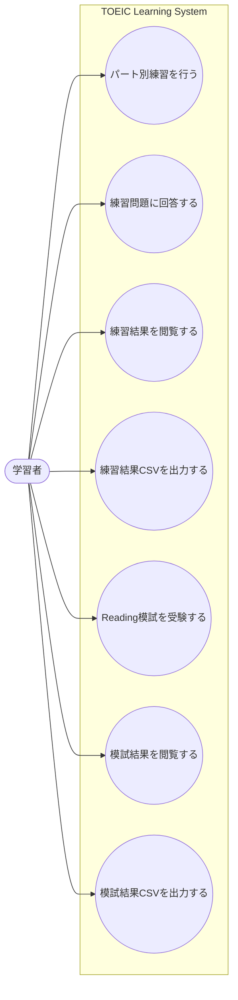

# ユースケース

## 1. 文書の位置付け

現行コードにログイン機能はありません。「学習者」はシステム利用者を表す概念上のアクターであり、ユーザーアカウントや権限を示すものではありません。

## 2. ユースケース図

## 3. ユースケース記述

| ID | ユースケース | 主アクター | 事前条件 | 基本結果 |
|---|---|---|---|---|
| UC-01 | パート別練習を行う | 学習者 | 対象Partの設問がDBにある | Part 5～7の問題が表示され、Part 6/7は関連本文と設問がまとまって表示される |
| UC-02 | 練習問題に回答する | 学習者 | 練習問題が表示されている | A～Dの回答をサーバーで採点し、回答履歴を1件追加して結果を表示する |
| UC-03 | 練習結果を閲覧する | 学習者 | Webアプリが利用可能 | 直近最大100件と、指定時は対象履歴の詳細を表示する |
| UC-04 | 練習結果CSVを出力する | 学習者 | WebアプリとDBが利用可能 | 練習履歴全件をCSVでダウンロードする |
| UC-05 | Reading模試を受験する | 学習者 | 必要なPart別問題がDBにある | Part 5～7計100問を75分で解答し、集計結果を保存する |
| UC-06 | 模試結果を閲覧する | 学習者 | Webアプリが利用可能 | 直近最大100件と、指定時は対象模試の集計詳細を表示する |
| UC-07 | 模試結果CSVを出力する | 学習者 | WebアプリとDBが利用可能 | 模試結果全件をCSVでダウンロードする |

## 4. 例外・代替フロー

- UC-01: パート番号が不正な場合は選択画面にエラーメッセージを表示する。問題がない場合は問題なしメッセージを表示する。
- UC-02: 問題ID、パート、回答が不正な場合はHTTP 400。DBエラー時は処理エラーとしてコンテナへ伝える。
- UC-03/UC-06: ID形式が不正ならHTTP 400、存在しないIDならHTTP 404。結果がない場合も一覧画面を表示する。
- UC-05: 必要数の問題が取得できない場合は模試開始処理をエラーにする。期限を過ぎて提出された場合、コード上は全問未回答として結果を保存する。
- UC-04/UC-07: `type` が `practice` または `mock` 以外の場合はHTTP 400。

## 5. 対応する処理図

- [練習問題表示シーケンス図](11_シーケンス図_練習問題表示.md)
- [練習回答登録シーケンス図](12_シーケンス図_練習回答登録.md)
- [模試開始・提出シーケンス図](13_シーケンス図_模試.md)
- [結果閲覧・CSV出力シーケンス図](14_シーケンス図_結果閲覧・CSV.md)
