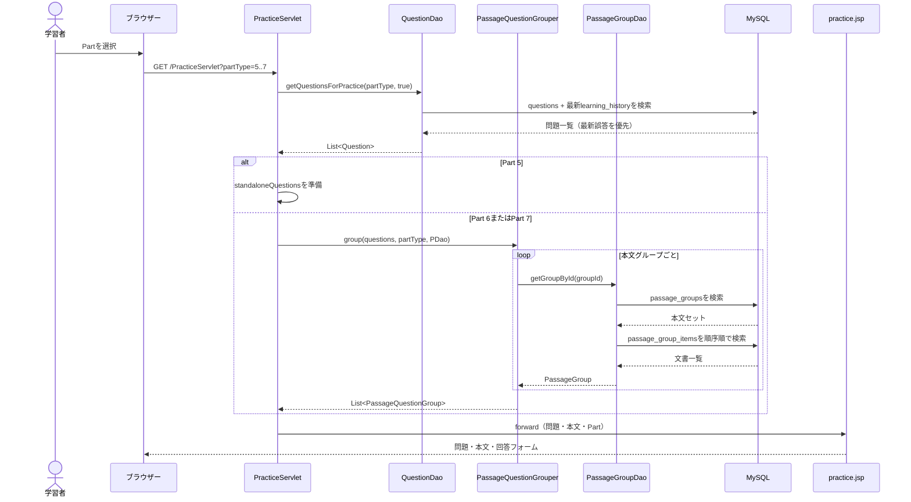

# シーケンス図：練習問題表示

## 1. 対象

`PracticeServlet` がパート別設問を取得し、Part 6/7では本文セット・文書と設問を集約して練習画面へ表示する処理です。最新回答が誤答の設問を先に並べる処理を含みます。

## 2. シーケンス図

## 3. 実装上の注意

- `partType` がない場合はパート選択画面を表示します。
- Part 5～7以外や数値でない値はエラーメッセージとして扱います。
- 本文グループに属さない設問は単独設問として表示します。Part 6/7の設問で本文グループが欠落している場合、グルーピング処理はエラーとなります。
- Mermaid図はソース実装に基づく処理概要で、各SQLの詳細は `04_詳細設計書.md` を参照してください。

