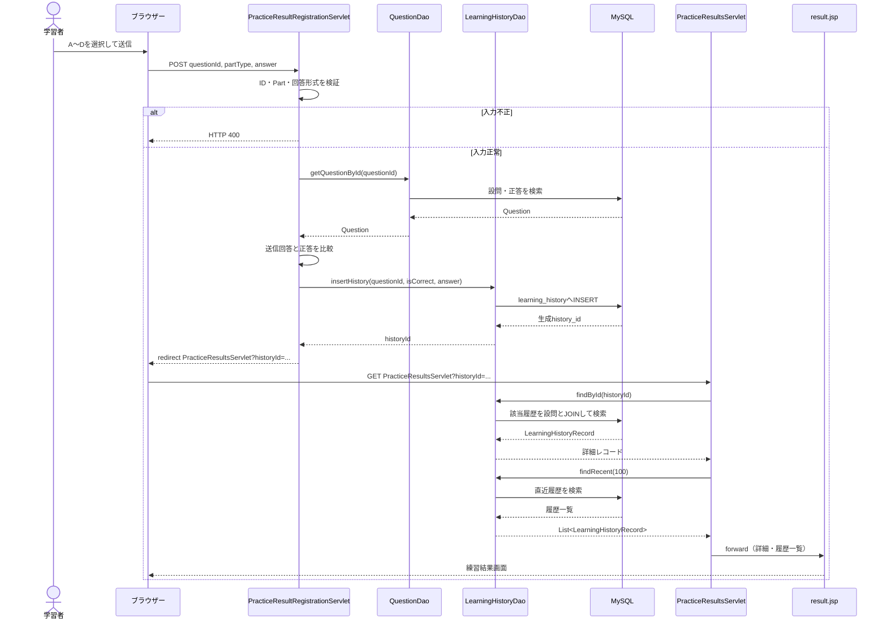

# シーケンス図：練習回答登録

## 1. 対象

利用者の回答をサーバーで検証・採点し、回答履歴を保存後、結果詳細と直近履歴を表示する処理です。

## 2. シーケンス図

## 3. 実装上の注意

- 回答記号はA～D（大文字・小文字不問）のみ受け付けます。無効値、問題ID、パートの不整合はHTTP 400です。
- 正誤判定はクライアントではなくServletで行います。
- 回答ごとに履歴を追加します。正答後も過去履歴は削除しません。
- 結果画面には対象履歴の詳細と直近最大100件を表示します。
- SQLの項目とエラー動作は `04_詳細設計書.md`、履歴の論理項目は `05_DB設計書.md` を参照してください。

