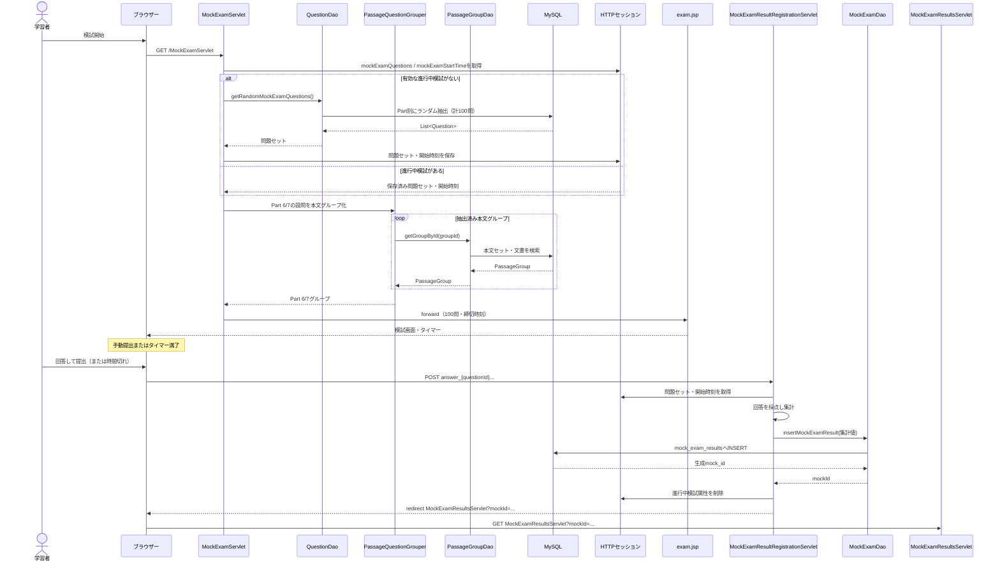

# シーケンス図：模試開始・提出

## 1. 対象

Reading模試の問題抽出、HTTPセッションへの進行状態保持、画面表示、採点、結果集計の保存を示します。

## 2. シーケンス図

## 3. 抽出数と制約

| Part/形式 | 抽出数 |
|---|---:|
| Part 5 | 30 |
| Part 6 | 16 |
| Part 7 SINGLE | 29 |
| Part 7 DOUBLE | 10 |
| Part 7 TRIPLE | 15 |
| 合計 | 100 |

- 現行処理は設問単位の抽出です。本文セットに含まれる全設問を抽出する保証はありません。
- 制限時間は75分です。ブラウザーのJavaScriptタイマーが期限到達時にフォームを送信します。
- サーバーは75分30秒を超えて提出された場合、全問未回答として扱い、集計結果を保存します。
- 結果として保存されるのは集計値であり、設問別の回答内容や正誤は保持されません。

