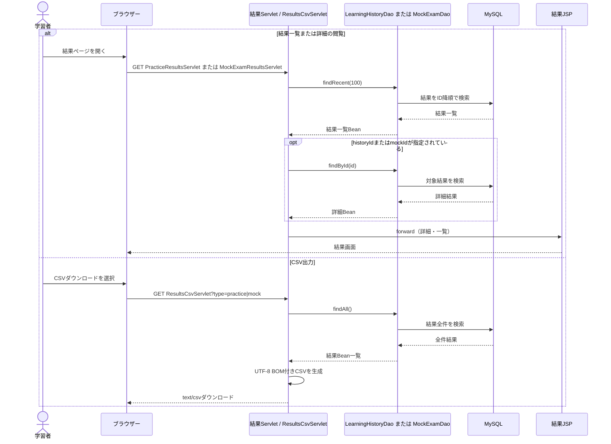

# シーケンス図：結果閲覧・CSV出力

## 1. 対象

練習履歴・模試結果の一覧および詳細を画面表示する処理と、対象データ全件をCSVで返す処理を示します。

## 2. シーケンス図

## 3. 実装上の注意

- 画面表示の一覧は直近最大100件です。ID指定時は一覧に対象詳細も表示します。
- CSV出力は `findAll()` による全件出力で、期間指定・ページングはありません。
- CSVはUTF-8 BOM付きです。セル値は引用符で囲み、引用符をエスケープします。
- `practice` と `mock` 以外の `type` はHTTP 400です。
- CSV項目・文字コード・エスケープ仕様は `04_詳細設計書.md` を参照してください。

