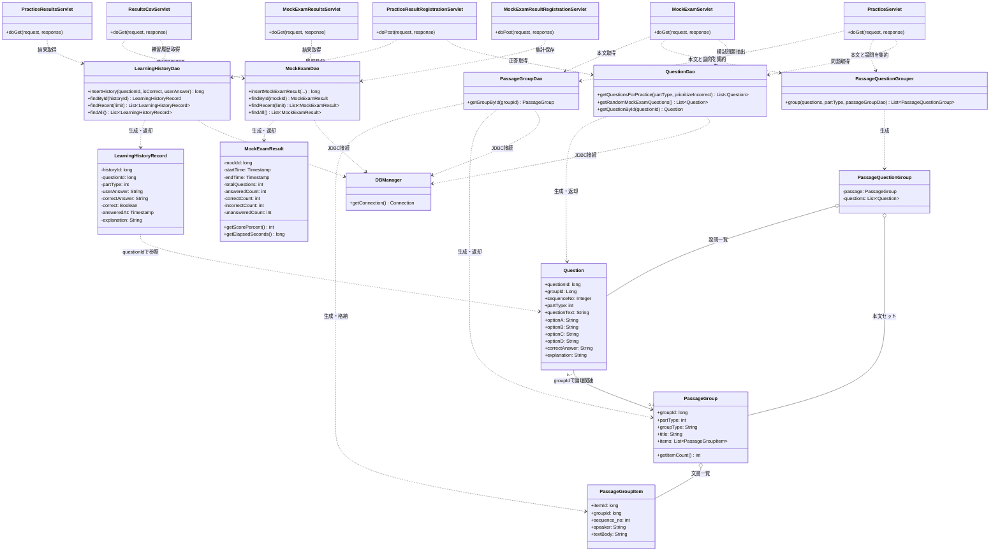

# クラス図

## 1. 文書の位置付け

本書は現行Javaソースの主要クラスと依存関係を示すAs-builtクラス図です。DB関連はコードから読み取れる論理関係であり、実DBの外部キー制約を示すものではありません。

## 2. クラス図

## 3. クラス図の読み方

- ControllerはHTTPリクエストを受け付け、DAOを呼び出してJSPへforwardまたはredirectします。
- DAOは `DBManager` からJDBC接続を取得します。
- `PassageQuestionGrouper` はPart別に設問を本文グループごとに集約し、`PassageQuestionGroup` を生成します。
- `Question` と `PassageGroup` の関係は `groupId` によるデータ上の関連です。Javaオブジェクトに双方向コレクションを保持する設計ではありません。
- `MockExamResult` は模試集計Beanです。設問ごとの回答明細を保持するクラスは現行実装にありません。
